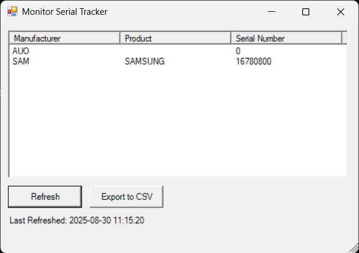

# MonitorTool

A Windows PowerShell utility for identifying connected monitors and retrieving hardware details such as manufacturer, model, and serial number.

MonitorTool is a small but practical project built to simplify monitor inventory, troubleshooting, and asset tracking on Windows systems. It uses WMI to query monitor metadata and presents the results in a clean, readable format.

## Overview

Many support and IT workflows require quickly identifying a monitor’s model or serial number without manually inspecting the hardware. This utility fills that gap by reading monitor information directly from the system.

The project currently includes:
- a lightweight command-line script for automation and scripting workflows
- a simple Windows Forms GUI for quick manual inspection

## Features

- Query connected monitors using the Windows WMI API
- Retrieve:
  - manufacturer
  - model / friendly name
  - serial number
- Output results as PowerShell objects for further scripting
- Offer a GUI-based interface for quick review
- Work with standard Windows PowerShell environments

## Why this project exists

This project demonstrates a practical use case for Windows automation:
- identifying hardware details without opening the device
- reducing manual troubleshooting effort
- supporting hardware audits and inventory checks
- creating a reusable utility for support workflows

## Repository structure

- `Get-MonitorInfo.ps1` — command-line script for retrieving monitor metadata
- `test_gui_02.ps1` — Windows Forms GUI version for user-friendly display
- `screenshots/` — UI examples and screenshots
- `README.md` — project documentation

## Requirements

- Windows 10 or Windows 11
- PowerShell 5.1 or PowerShell 7+
- Windows Management Instrumentation (WMI) enabled

## Installation

Clone the repository:

```powershell
git clone https://github.com/osamacaiser/MonitorTool.git
cd MonitorTool
```

## Usage

### Command-line version

Run the script from PowerShell:

```powershell
.\Get-MonitorInfo.ps1
```

Example output:

```powershell
Manufacturer Model        SerialNumber
------------ -----        ------------
DELL         U2415        ABC123XYZ
HP           E243         9LM87654
```

This script returns one object per monitor and can be used in further automation or exported to CSV or JSON if extended.

### GUI version

Launch the graphical interface:

```powershell
.\test_gui_02.ps1
```

This opens a Windows Forms window showing the monitor list and basic metadata in a table.

## How it works

The project uses the `WmiMonitorID` WMI class in the `root\wmi` namespace. This class exposes monitor metadata, including manufacturer and serial information. The script converts the raw WMI byte arrays into readable strings and outputs them in a clean format.

## Example object output

```powershell
@{
  Manufacturer = 'DELL'
  Model        = 'U2415'
  SerialNumber = 'ABC123XYZ'
}
```

## Screenshot



## Current status

MonitorTool is a focused utility designed to solve a very specific problem: identifying monitor hardware information quickly and reliably on Windows systems. It is intentionally simple, easy to run, and practical for real-world support and inventory tasks.

## Potential improvements

This project can evolve into a stronger portfolio asset with future enhancements such as:
- CSV export support
- JSON output support
- remote workstation monitoring
- improved parameter validation and error handling
- modular PowerShell structure
- automated tests and CI validation
- more polished GUI filtering and reporting

## License

This project is licensed under the MIT License. See the [LICENSE](LICENSE) file for details.

## Notes

This project is best viewed as a useful, low-complexity automation tool rather than a large application. Its strength is in solving a real problem clearly and efficiently with minimal overhead.
